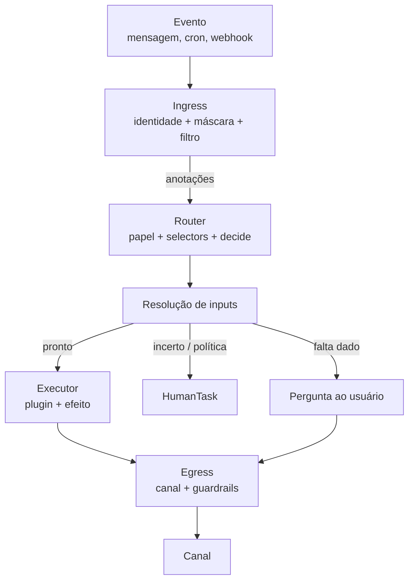
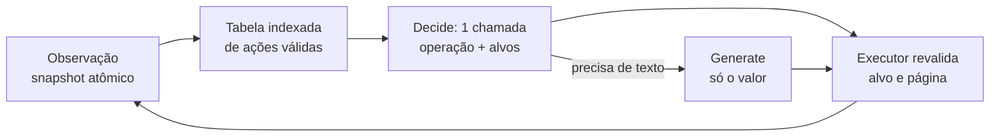
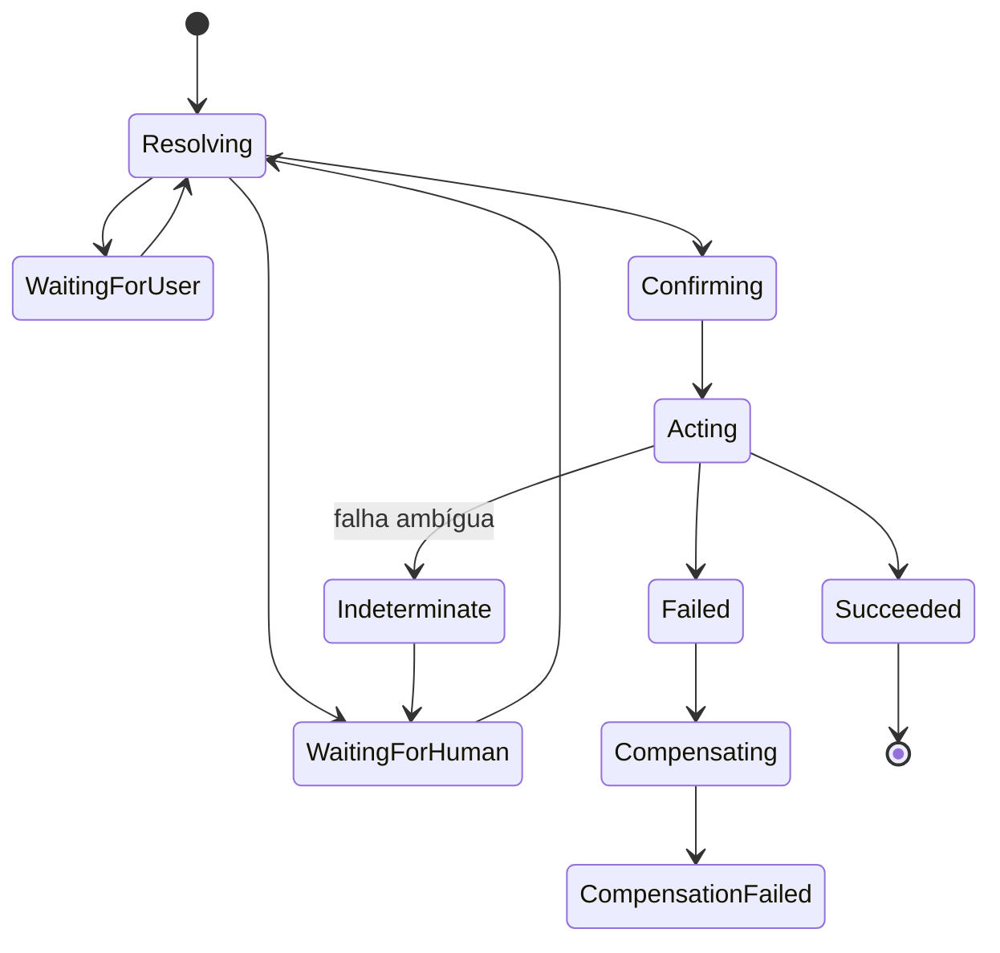

# RFC-0001 — Plataforma declarativa de agentes (codinome `agentd`)

Sep 22, 2026 · @Someone

## Resumo

Propomos construir do zero uma plataforma aberta a terceiros para definir, executar e operar agentes de forma declarativa: o autor descreve **o que** o agente precisa entender, garantir e fazer, e a plataforma decide **como** chegar lá. O modelo é o do Kubernetes (recursos com `spec`/`status`, admissão, controllers, extensão por plugins), com execução durável e humano no circuito por padrão.

**Diferencial em uma frase:** decisões tipadas e separadas da geração de texto, efeitos com garantias declaradas e aplicadas na fronteira das ferramentas, e humano no circuito nativo nos canais de mensagem, tudo reproduzível contra versões novas. Nenhum framework atual junta essas quatro coisas (ver "Por que não X").

**Status:** v0.3: métricas de negócio e experimentos nativos; v0.2 revisada após revisão adversarial (54 achados; ver o histórico no fim). **Codinome:** `agentd` (servidor) e `agentctl` (CLI) — provisórios; `agentctl` já existe em outro projeto. **Código:** repositório novo, binário novo.

**Distribuição:** open source e self-hosted, com uma cloud gerenciada por cima. A cloud vai permitir criar agentes em linguagem natural, mas isso fica para um RFC separado: aqui só entra a infra que ela usa. O criador em linguagem natural será um cliente da mesma API, CLI e servidor MCP que qualquer agente de código usa, sem caminho privilegiado.

### Por que agora

Plataformas anteriores de agentes em produção provaram uma tese: o código controla o fluxo e o LLM decide pontos pequenos dentro dele. Elas resolveram problemas que quase nenhum framework trata (idempotência, dependências, checkpoints com pausa e retomada, triggers por cron, aprovação humana), mas costumam acumular dívidas estruturais que não se resolvem por refatoração:

- uma DSL que vira linguagem de programação sem tipos, com shell e texto no meio;
- valores do usuário entrando em shell por substituição de texto;
- uma interface com o LLM sem tipos: chat completion, parse de texto e novas tentativas, com confiança inventada pelo modelo;
- um motor que perde modularidade, onde cada operação nova toca muitos arquivos.

### O que mudou no mundo

Modelos System One como o Jev (TypeSafe) devolvem decisões tipadas com probabilidades em \~700ms. Isso permite separar, na arquitetura, **decidir** de **gerar**.

## Objetivos e não-objetivos

### Objetivos

1. **Plataforma para terceiros.** Uma empresa de fora consegue definir, testar, publicar e operar um agente sem ler o código do core nem falar com a gente.
2. **Declarativo e tipado.** Toda definição é um recurso versionado (`apiVersion`/`kind`), validado por schema antes de rodar. Todo valor que circula tem tipo; nada é passado por substituição de texto.
3. **Decidir separado de gerar, com dois motores de decisão.** O Jev é o padrão da cloud. O open source roda com Jev ou com um LLM restrito às opções, e toda `EvalSuite` obrigatória precisa passar nos dois. Texto passa por LLMs; contas e datas passam por código.
4. **Garantias honestas sobre efeitos.** A plataforma diz exatamente o que garante em cada ação externa (pelo menos uma vez, ou efetivamente uma vez quando o sistema externo permite) e manda para um humano o que não dá para saber.
5. **Humano no circuito por padrão.** Escalação, aprovação e handoff existem em todo agente sem configuração extra; o autor só ajusta.
6. **Execução durável e determinística na retomada.** Qualquer passo sobrevive a queda de processo, e retomar nunca muda uma decisão já tomada.
7. **Feita para ser usada por agentes de código.** Claude Code, Codex e Cursor conseguem criar, validar, testar e publicar agentes só com a CLI e a documentação.
8. **Documentação rica desde o primeiro commit**, gerada em parte a partir dos schemas, para nunca ficar desatualizada.
9. **Explicável.** Para qualquer ação, `agentctl describe` mostra por que ela aconteceu, com as probabilidades de cada decisão.
10. **Conforme à LGPD por padrão.** Dados pessoais são mascarados antes de sair para qualquer modelo externo, e o direito à exclusão funciona mesmo com o log de eventos.
11. **Números do negócio nativos.** Cada agente mede o resultado que importa (contatos que viram agendamentos e presença, cotações que viram vendas, tempo por etapa), acompanha com alertas e testa variações com A/B de verdade, sem SQL escrito à mão por tenant.

### Não-objetivos (nesta versão)

- **Rodar dentro do Kubernetes.** O modelo é inspirado no k8s, mas `agentd` é um binário único que roda em qualquer lugar. Um operator para k8s pode vir depois.
- **Construtor visual (no-code).** A interface primária é o arquivo de definição e a CLI; uma UI pode ler e escrever os mesmos recursos depois.
- **Treinar ou hospedar modelos.** A plataforma consome provedores (TypeSafe, Anthropic, OpenAI, Google, OpenRouter).
- **Agente autônomo aberto ("faça qualquer coisa").** A plataforma otimiza para fluxos com efeitos controlados; raciocínio aberto entra como um passo, não como o motor principal.

## Por que não X

Nenhuma ferramenta existente cobre o conjunto: decisão tipada, efeitos com garantias, HIL nativo em canais de mensagem e plataforma declarativa para terceiros. Algumas cobrem partes e podem ser usadas por baixo.

| Alternativa | O que faz bem | O que falta para o nosso caso | Relação com o `agentd` |
| --- | --- | --- | --- |
| Temporal, Restate | Execução durável, retomada determinística, timers | Nada de LLM, decisão, canal, HIL ou modelo declarativo | Candidatos a motor durável por baixo; decisão no spike da fase 0 |
| LangGraph | Grafos de agentes, checkpoints, interrupção para humano | Biblioteca (Python/JS), não plataforma multi-tenant; efeitos sem garantias declaradas | Referência de HIL por interrupção |
| OpenAI Agents SDK, Mastra | Tools, handoffs, guardrails em código | Biblioteca imperativa; sem durabilidade nem modelo de efeitos | Podem rodar como runtime de `delegate` |
| Dapr Agents | Agentes sobre workflows duráveis do Dapr | Depende do Dapr; sem decisão tipada nem HIL de canal | Referência |
| kagent (CNCF) | Agentes rodando dentro do Kubernetes, voltados a operação de clusters | Outro público (SRE); exige k8s | Nome e analogia próximos; posicionar a diferença com clareza |

### A analogia com o Kubernetes, com limites

Do k8s vem o **modelo de recursos**: `spec`/`status`, admissão, `explain`, controllers para recursos declarativos e extensão por plugins. A **execução** não é reconciliação: conversas são eventos, e efeitos como enviar mensagem ou marcar consulta não convergem, acontecem uma vez. Por isso os `Run`s seguem o modelo de sagas e workflows duráveis, não o de reconciliação. O "k8s para agentes" é a experiência do autor e do operador, não a semântica de execução.

## Princípios de design

Cada princípio abaixo existe porque sua ausência custa caro em plataformas de agentes em produção. Em caso de conflito, a ordem da lista é a ordem de prioridade.

1. **Seguro por construção.** Nenhum valor vindo de usuário, LLM ou API externa é concatenado em código, shell ou SQL. Valores trafegam como dados tipados; código de usuário roda sempre em sandbox com limite de CPU e memória.
2. **Garantias honestas.** A plataforma nunca promete "exatamente uma vez" para um sistema externo que não permite verificar. O que não dá para saber vira uma fase explícita e vai para um humano.
3. **Declarar a intenção, não o procedimento.** O autor diz o que precisa ser verdade (inputs satisfeitos, pré-condições, efeito desejado). A plataforma resolve até chegar lá ou escala para um humano.
4. **Cada chamada primitiva usa um motor.** Decidir, gerar, calcular e agir têm contratos separados. Tipos de passo compostos (`extract`, `ask`, `delegate`) são documentados como composição dessas chamadas, e cada chamada aparece separada no trace.
5. **Falha barulhenta.** Campo desconhecido é erro de validação, não é ignorado. Referência que não resolve é erro na publicação, não em produção. Todo exemplo da documentação passa na validação.
6. **Efeitos são cidadãos de primeira classe.** Toda ação declara sua classe de efeito e como pode ser verificada; a plataforma aplica idempotência, confirmação, compensação e auditoria de acordo com isso.
7. **Todo não-determinismo vira evento.** Respostas de modelo, leituras de plugin, horário e IDs aleatórios são gravados. Retomar uma execução reusa o que foi gravado; nunca pergunta de novo.
8. **Incerteza é um sinal, não um erro.** Toda decisão vem com probabilidade e com a indicação de se ela é calibrada. Abaixo do limite, o fluxo segue um caminho definido: perguntar ao usuário, usar um modelo maior ou chamar um humano.
9. **Autorização não é probabilística.** Quem pode fazer o quê vem de identidade verificada e de regras, nunca de um modelo. Modelos podem sugerir; aprovações e permissões são determinísticas.
10. **O core não conhece nenhum domínio.** Agenda, WhatsApp e o CRM são plugins. Se para suportar um cliente for preciso mudar o core, o modelo de extensão falhou.
11. **A máquina é um usuário de primeira classe.** Toda operação da CLI tem saída em JSON, erros têm código estável e mensagem com a correção sugerida, e toda a documentação existe também em formato legível por agentes.

## Modelo de recursos

Tudo na plataforma é um recurso com `apiVersion`, `kind`, `metadata`, `spec` (o que o autor quer) e `status` (o que a plataforma observou). YAML e JSON são formas equivalentes do mesmo objeto; o schema de cada `kind` é publicado em JSON Schema e é a fonte da validação, da documentação e do autocomplete.

### Recursos que o autor escreve

| Kind | Para que serve |
| --- | --- |
| `Agent` | Identidade, persona, canais, idiomas, fuso horário, backends de modelo e política de HIL padrão |
| `Intent` | Uma coisa que o usuário pode querer; descrição e exemplos usados pelo roteador |
| `Function` | Uma capacidade: inputs tipados, autorização, pré-condições, ação, saída |
| `Workflow` | Composição durável de passos com espera, desvio e compensação. **Decidido (ADR-0006): não é um kind separado;** uma `Function` com `wait` (tempo, resposta, eventos) é o workflow |
| `Trigger` | Quando algo começa: mensagem com certa anotação, cron no fuso do agente, webhook, evento de outro recurso |
| `Decision` | Pergunta tipada reutilizável (choice, noul, score) com limites e fallback |
| `Guardrail` | Verificação antes de agir ou antes de enviar; determinística quando possível |
| `Schema` | Tipo definido pelo autor (JSON Schema), usado em inputs, saídas, memória e `delegate` |
| `HumanQueue` | Para onde vão escalações e aprovações: quem, por qual canal, com qual SLA |
| `Connection` | Credenciais e endpoint de um sistema externo, sempre por referência a segredo do mesmo namespace |
| `KnowledgeBase` | Fontes para RAG e memória, com origem e política de retenção |
| `EvalSuite` | Casos esperados para decisões, funções e conversas inteiras |
| `Subject` | De quem são os números: lead, paciente, viajante; identidade estável e atributos tipados |
| `Funnel` | Etapas de marcos, coortes, conversão entre etapas, tempo por etapa e alerta de parados |
| `Metric` | Contagens, razões, percentis e custo por resultado sobre marcos |
| `Experiment` | A/B com sorteio estável, métrica principal, guardrails e análise |

Plugins podem publicar `kind`s próprios, como o `MessageTemplate` do plugin de WhatsApp (ver "Extensibilidade").

### Recursos que a plataforma cria (só `status`)

| Kind | O que representa |
| --- | --- |
| `Conversation` | Uma conversa com um usuário em um canal, com seu histórico, anotações e a fila de eventos |
| `Run` | Uma execução de `Function` ou `Workflow`, presa à versão em que começou. Fases em "Execução durável" |
| `HumanTask` | Um pedido pendente para um humano (aprovação, resposta, input, takeover, revisão), com prazo |
| `DecisionRecord` | Cada decisão tomada: pergunta, estado enviado (já mascarado), probabilidades, backend, modelo e se é calibrada |
| `Milestone` | Um marco de negócio de um sujeito: nome, hora, atributos, de qual efeito ou evento veio |
| `Assignment` | A variante de um experimento sorteada para um sujeito, na primeira exposição |

### Expressões, literais e escopos

Uma regra só decide o que é expressão e o que é texto, para que nenhum exemplo seja ambíguo:

- **Campos do tipo `Expr` no schema são sempre [CEL](https://cel.dev), sem delimitador:** `when`, `cel`, `value`, `choices`, `authorize`, `idempotencyKey`. O `agentctl explain` mostra o tipo de cada campo.
- **Qualquer outro campo é literal.** Para usar expressão nele, o valor inteiro é `"${ expressão }"` e o resultado mantém o tipo (não vira texto).
- **Textos para pessoas** (`text`, `template`, `confirm`) interpolam `{{ expressão }}` e escapam de acordo com o canal.
- **Escopos:** `inputs`, `sources.<id>` (dentro de `resolve`), `steps.<id>`, `event`, `caller`, `conversation`, `agent` e `env` (só valores não secretos).
- **Resultado de passo:** `steps.<id>` tem `status` (`succeeded`, `skipped`, `failed`) e `output`. Um passo pulado não tem `output`; use `has(steps.x.output)`.
- **Tempo:** não existe `now()`. O horário é `event.time`, o que mantém a retomada determinística. Extensões de CEL: `inTz(t, agent.timezone)`, `addBusinessDays` e `calendarDays`.
- **Custo:** toda expressão CEL tem orçamento de custo verificado na admissão e na execução.

### Exemplo completo

Uma função de remarcação para uma clínica. A classe de efeito de `agenda/reschedule` vem do manifesto do plugin (`irreversible`), não do autor.

```yaml
apiVersion: agents.agentd.dev/v1alpha1
kind: Function
metadata:
  name: reschedule-appointment
  namespace: clinica-exemplo
spec:
  description: Muda a data de uma consulta já existente.
  selector:
    intent: remarcar-consulta
  authorize: "caller.role == 'patient'"
  inputs:
    appointment:
      type: agenda.Appointment
      resolve:
        - id: upcoming
          fromAction: agenda/list-upcoming-appointments
          with: { patientId: "${ caller.patientId }" }
        - id: only
          when: "size(sources.upcoming.output) == 1"
          value: "sources.upcoming.output[0]"
        - id: pick
          when: "size(sources.upcoming.output) > 1"
          ask:
            text: "Qual consulta você quer remarcar?"
            choices: "sources.upcoming.output"
            minConfidence: 0.7
            onLowConfidence: ask-user
      onUnresolved:
        - respond: { template: "Não encontrei consultas futuras no seu cadastro." }
    newSlot:
      type: agenda.Slot
      resolve:
        - id: slots
          fromAction: agenda/find-slots
          with:
            dentistId: "${ inputs.appointment.dentistId }"
            from: "${ event.time }"
            days: 7
        - id: pick
          ask:
            text: "Tenho estes horários: {{ sources.slots.output.map(s, s.label).join(', ') }}. Qual prefere?"
            choices: "sources.slots.output"
            minConfidence: 0.7
            onLowConfidence: ask-user
  preconditions:
    - cel: "inputs.newSlot.start > event.time + duration('2h')"
      message: "Remarcações precisam de 2 horas de antecedência."
  action:
    act: agenda/reschedule
    with:
      appointmentId: "${ inputs.appointment.id }"
      slotId: "${ inputs.newSlot.id }"
    confirm: "Confirmo a remarcação para {{ inputs.newSlot.label }}?"
    idempotencyKey: "inputs.appointment.id + ':' + inputs.newSlot.id"
  output:
    template: "Pronto! Sua consulta foi remarcada para {{ inputs.newSlot.label }}."
    guardrails: [sem-promessa-de-preco]
  onError:
    - escalate: { queue: recepcao, task: input }
```

O autor não escreveu nenhum prompt de classificação, nenhum parse e nenhuma chamada de modelo. O roteamento e a escolha da consulta e do horário viram `Decision`s geradas a partir do `spec`. A confirmação é um passo próprio (fase `Confirming`), e a mensagem final é template, não geração. O `status` que a plataforma escreve aparece em `agentctl get function reschedule-appointment -o yaml`, nunca no arquivo do autor.

## Arquitetura

A plataforma tem dois planos. O **control plane** aceita, valida e versiona definições. O **data plane** processa eventos e executa. Os dois compartilham o log de eventos, que é a fonte da verdade.

### Control plane

- **API server:** HTTP + gRPC, REST no estilo k8s (`/apis/agents.agentd.dev/v1alpha1/namespaces/{ns}/functions/{name}`), com `watch` para mudanças.
- **Admission:** validação por schema, resolução de referências (funções, tipos, ações, conexões, filas humanas), checagem de tipos e de custo das expressões CEL, regras de efeito (por exemplo: nada de `retry` depois de efeito irreversível sem verificação) e políticas do namespace. Nada inválido chega ao data plane.
- **Versionamento:** cada publicação gera uma `generation` imutável, que fixa também as versões de plugins e modelos. **Cada `Run` termina na versão em que começou; conversas não ficam presas a versão nenhuma**, porque conversas de WhatsApp nunca terminam. `Run`s longos (uma cadência de 15 dias) podem ser migrados por marcadores de versão nos passos, com `agentctl rollout --migrate-running`, ou cancelados em lote.
- **Registry de plugins:** cada plugin publica tipos, ações, classes de efeito e modo de verificação, como um CRD.

### Data plane: o caminho de um evento



1. **Ingress.** Normaliza o evento do canal (WhatsApp, email, webchat, API) em um formato único e resolve a identidade de quem enviou (`caller`) a partir do canal verificado. **Antes de qualquer modelo externo**, mascara dados pessoais localmente (CPF, telefone, email, cartão, termos de saúde). Depois faz **uma** chamada ao Decide com as perguntas de filtro: precisa de resposta, intenção, pedido de humano, urgência, frustração, idioma e se a mensagem responde a algum `ask` pendente. O resultado vira **anotações** na mensagem, como labels no k8s. No benchmark, 8 perguntas numa só chamada levaram \~740ms.
2. **Router.** Primeiro filtra as `Function`s que o papel de `caller` pode acionar; só então seleciona por anotações. Empate ou baixa confiança vira um `decide` entre os candidatos; abaixo do limite, o agente pergunta em vez de adivinhar.
3. **Resolução de inputs.** O antigo input fulfiller: para cada input pendente, tenta as fontes do `resolve` em ordem (ação, outra função, memória, extração da conversa, pergunta ao usuário) até satisfazer tipos, autorização e pré-condições. Cada tentativa é um evento durável.
4. **Executor.** Chama o plugin da ação e aplica a semântica da classe de efeito e do modo de verificação (idempotência, confirmação, compensação, fase `Indeterminate`).
5. **Egress.** Única saída para o usuário: nada responde por fora. Monta a resposta por template quando possível e por geração quando necessário, respeita as regras do canal (janela de 24h do WhatsApp) e roda os `Guardrail`s. Guardrails determinísticos rodam primeiro; os que usam modelo falham fechados.

### Componentes compartilhados

- **Event log:** append-only por conversa e por `Run`. Cada passo grava, numa única transação, o evento do `Run`, o evento da conversa, os timers e as mensagens de saída (outbox transacional). Filas só são alimentadas pelo outbox. SQLite no modo single-node; Postgres no modo cluster.
- **Motor durável:** pode ser próprio ou Temporal/Restate por baixo. A escolha sai de um spike na fase 0 (ver "Execução durável").
- **Scheduler de timers:** crons, prazos de `HumanTask`, esperas e lembretes são linhas com `fire_at`, reivindicadas com lease e token de cerco (`FOR UPDATE SKIP LOCKED` no Postgres). O disparo tem ID determinístico, então repetições são descartadas. Usa o relógio do banco, não o dos nós.
- **Model gateway:** única porta de saída para modelos. Aplica a política de dados por provedor, orçamento e fila justa por tenant, prioridades, cache com tenant na chave, retry, fallback e registro de custo e latência.
- **Secrets:** referências a cofre (arquivo local, Vault, AWS/GCP Secret Manager), sempre do mesmo namespace; entregues ao plugin por chamada, nunca aparecem em `spec`, logs ou traces.

### Entrega de eventos por conversa

- **Um passo por vez por conversa, não um `Run` por vez.** Cada conversa tem uma caixa de entrada com um único escritor. `Run`s esperando (usuário, humano, timer) liberam a caixa, então o agente continua atendendo outros assuntos enquanto um `Run` espera.
- **Cada evento vai para exatamente um consumidor**, e a entrega fica registrada. Ordem de prioridade: (1) o `ask` pendente mais recente que a anotação do Ingress associou à mensagem; (2) um `wait` por evento que casa por conversa e `Run`, nunca só por telefone; (3) o Router.
- **Triggers não interrompem `Run`s ativos por padrão.** Cada `Trigger` declara `interrupts: never | same-intent | always`. Assim um trigger sempre ligado não sequestra uma cadência em andamento.

### Tempo e fuso horário

O log é sempre UTC. Cada namespace declara um fuso IANA (por exemplo `America/Sao_Paulo`), e crons, janelas de envio, "D+3" e SLAs em horas úteis são calculados nesse fuso. A suíte de testes do core cobre transições de horário de verão.

### Capacidade e justiça entre tenants

- **Orçamento de chamadas ao Decide por mensagem** (padrão 3). A admissão avisa quando um agente passa disso.
- **Fila justa por tenant** no gateway, com classes de prioridade: tráfego ao vivo, depois guardrails, depois lotes de cron. Campanhas de saída são cadenciadas pela capacidade disponível do Decide.
- **Modo degradado definido:** quando o Decide esgota, o fallback tem teto próprio; acima dele, o agente responde com template de espera e escala, em vez de acumular latência.

## Os quatro motores

Toda chamada primitiva da plataforma usa exatamente um de quatro motores. Tipos de passo compostos (`extract`, `ask`, `delegate`) encadeiam chamadas de motores diferentes, e cada chamada aparece separada no trace.

| Motor | Responde a | Saída | Backends | Se falhar |
| --- | --- | --- | --- | --- |
| **Decide** (System 1) | "Qual destas opções?", "Isto é verdade?", "Quanto, numa escala?" | Valor tipado + probabilidades + confiança + `calibrated` | `typesafe` (Jev; padrão na cloud) e `llm-constrained` (padrão no open source) | O outro backend, com teto; depois modo degradado |
| **Generate** (System 2) | "Escreva", "Resuma", "Raciocine em aberto" | Texto ou objeto validado por schema | LLMs via model gateway | Outro provedor |
| **Compute** | Contas, datas, filtros, transformações | Valor tipado, determinístico | CEL (expressões) e Starlark (lógica), em sandbox | Nenhum: erro é erro |
| **Act** | Efeitos no mundo externo | Resultado tipado do plugin | Plugins | Conforme classe de efeito e `onError` |

### Contrato do Decide

```go
type Decider interface {
    Decide(ctx context.Context, req DecideRequest) (DecideResponse, error)
}

type DecideRequest struct {
    State     any                 // já filtrado e mascarado pelo chamador
    Questions map[string]Question // Choice (≤255 opções), Noul (sim/não), Score (≤10 níveis)
}

type Answer struct {
    Value         any                // string | bool | float64
    Probabilities map[string]float64
    Confidence    float64
    Calibrated    bool               // false quando o backend não tem calibração medida
    Backend       string             // "typesafe" | "llm-constrained"
    Model         string             // ex.: "jev-1.13.0"
}
```

O contrato espelha a API do Jev, mas não depende dela. O backend `llm-constrained` pede ao LLM que escolha só entre as opções e, quando o provedor expõe logprobs, deriva as probabilidades deles; sem logprobs, marca `calibrated: false`. Cada backend tem seu **perfil de limites**: `minConfidence` (choice e score) e `threshold` (noul) são definidos por backend, e decisões não calibradas vão para `ask-user` ou `human` com limites mais conservadores. Todo `Decision` declara o limite e o `onLowConfidence` (`ask-user`, `escalate-model`, `human`), e o resultado é gravado como `DecisionRecord`.

### Por que o Jev é o padrão da cloud

Benchmarks com casos sintéticos compararam o Jev com LLMs pequenos sob as mesmas perguntas: o acerto empatou, e a confiança do Jev separa respostas certas de erradas, com latência menor. A decisão e seus limites estão no [ADR-0003](../adr/0003-jev-is-the-decide-engine.md). Qualquer outro backend de Decide pode ser medido com `tessera bench decide`.

### Regras de uso do Jev (vindas da documentação de limitações do jev-1.13)

- **Datas, números e contagem vão para o Compute.** O Decide pode extrair componentes (mês, dia); a comparação é código.
- **O estado é filtrado antes.** Limite de 32 mil tokens para estado + maior pergunta; o Reconciler envia só os campos que a pergunta referencia.
- **Perguntas literais.** O linter do `agentctl` avisa sobre negações duplas e critérios que contradizem a instrução.
- **Conteúdo adversarial não é confiável só com o Jev.** A detecção de manipulação no Ingress é uma camada, não a única.
- **Versão fixada em produção.** Namespaces fixam `jev-1.13.0`, não `jev-latest`, e sobem de versão rodando as `EvalSuite`s antes.

### Padrão: laço de ação indexado

Para qualquer plugin interativo (browser, desktop, escolha de tools pelo agente), a plataforma adota o padrão do [jev-ultrafast](https://github.com/browser-use/jev-ultrafast), da Browser Use com a TypeSafe. Eles relatam uma busca real no Google Flights em 7,1s; a comparação que publicam é entre duas versões do próprio agente, em 3 execuções de uma tarefa, e eles mesmos dizem que não é um benchmark geral. O padrão entra aqui pelo desenho de segurança, não pelos números.



1. **Espaço de ações dinâmico.** A cada ciclo, o plugin publica uma tabela numerada só com as ações possíveis naquele estado (por exemplo `[3] combobox Destino · vazio`), mais `DONE` e `BLOCKED`.
2. **Uma chamada, várias cabeças especulativas.** O Decide escolhe a operação e, na mesma requisição, o alvo de cada operação candidata. Só a cabeça da operação escolhida é usada.
3. **Geração só onde é texto.** Um LLM pequeno escreve o valor quando a operação é digitar, e a saída precisa passar por um schema.
4. **O executor não confia no modelo.** O alvo é resolvido a partir de um nó observado, e o executor checa se a página ainda é a mesma e se o elemento está visível. A saída do modelo nunca vira seletor, coordenada, shell ou JavaScript.
5. **`DONE` exige verificação independente.** O fim da tarefa é checado por uma condição do `spec` (Compute ou Decide), não pela palavra do modelo.

O SDK de plugins oferece esse laço pronto (`ActionSpace`, `Observe`, `Execute`, `Verify`). O mesmo padrão evita o anti-padrão de pedir ao modelo a próxima ação em texto livre, como `tool: justificativa` em texto livre: até 255 opções por escolha, e acima disso dois estágios (pontuar e depois escolher).

## Tipos de passo

Uma `Function` ou `Workflow` é feita de passos, e cada passo tem exatamente um tipo. São 16 tipos, num conjunto fechado: capacidade nova entra como plugin, não como tipo novo. (A v0.1 chamava isto de "operadores"; o nome mudou para não confundir com operators do k8s nem com papéis de RBAC.)

| Tipo | Motores | O que faz |
| --- | --- | --- |
| `decide` | Decide | Faz uma ou mais perguntas tipadas (choice, noul, score) e devolve valor + probabilidades |
| `extract` | Decide, depois Generate | Preenche um `Schema` a partir da conversa; campos fechados via Decide, texto curto via Generate (composto) |
| `generate` | Generate | Texto ou objeto validado por schema |
| `compute` | Compute | Expressão CEL ou função Starlark |
| `act` | Act | Chama uma ação de plugin, com as garantias da classe de efeito |
| `call` | — | Executa outra `Function` com inputs tipados |
| `ask` | Egress, espera, depois Decide | Pergunta ao usuário, espera de forma durável e interpreta a resposta contra o tipo esperado (composto) |
| `escalate` | — | Cria uma `HumanTask` e espera |
| `respond` | Egress | Envia mensagem ao usuário: template ou geração, sempre com guardrails e regras do canal |
| `wait` | — | Espera tempo, evento ou condição, com timeout, no fuso do agente |
| `branch` | Compute ou Decide | Desvia por expressão CEL ou por resultado de `decide`; precisa cobrir todos os casos ou ter `else` |
| `parallel` | — | Roda passos ao mesmo tempo; declara se a falha de um cancela os outros |
| `foreach` | — | Repete sobre uma lista, com limite de concorrência |
| `emit` | — | Publica um evento que dispara `Trigger`s (via outbox) |
| `remember` | — | Grava fato tipado na memória, com origem; fatos vindos do usuário são marcados como não confiáveis |
| `delegate` | Generate + Act | Entrega uma subtarefa ao modo livre, dentro de um envelope de autonomia (composto; seção seguinte) |

Qualquer passo aceita os mesmos modificadores: `when`, `timeout`, `retry`, `onError`, `cache` e `idempotencyKey`. Todo passo produz o mesmo envelope de resultado: `status` (`succeeded`, `skipped`, `failed`) e `output`.

### Exemplo: cadência de follow-up de vendas

```yaml
apiVersion: agents.agentd.dev/v1alpha1
kind: Workflow
metadata: { name: outbound-cadence, namespace: qg21 }
spec:
  inputs:
    lead: { type: crm.Deal }
  steps:
    - id: first-touch
      act: whatsapp/send-template
      with:
        to: "${ inputs.lead.phone }"
        template: apresentacao-v3          # literal: nome do MessageTemplate
    - id: reply
      wait:
        event: message.received          # literal: tipo de evento
        timeout: 2 calendarDays          # D+2 no fuso do agente
    - id: intent
      when: "steps.reply.status == 'succeeded'"
      decide:
        state: { message: "${ steps.reply.output.text }" }
        choice:
          interessado: Quer saber mais ou agendar
          sem-interesse: Recusa clara
          opt-out: Pede para não receber mais mensagens
          outro: Qualquer outra coisa
        minConfidence: 0.7
        onLowConfidence: human
    - id: route
      branch:
        - when: "steps.reply.status != 'succeeded'"
          call: second-touch
        - when: "steps.intent.output.value == 'opt-out'"
          call: register-opt-out
        - when: "steps.intent.output.value == 'interessado'"
          call: qualify-and-schedule
        - when: "steps.intent.output.value == 'sem-interesse'"
          call: mark-lost
        - else:
            escalate: { queue: vendas, task: answer }
```

O `wait` casa a resposta pela conversa e pelo `Run`, não pelo telefone. Se a janela de 24h do WhatsApp fechar, `second-touch` só pode usar template aprovado; a admissão recusa texto livre ali.

### Controllers internos

Cada `kind` com comportamento tem um controller que observa o event log: `ConversationController`, `RunController`, `HumanTaskController` e `TriggerController`. A publicação de versões (`rollout`) é feita pelo API server, sem controller próprio. Plugins podem registrar controllers para os `kind`s que definem, e recebem só eventos já filtrados para o seu namespace.

## Dois mundos: estruturado e livre

A plataforma suporta os dois estilos no mesmo agente. Autonomia não é uma escolha da plataforma, é uma propriedade de cada passo. A liberdade é segura porque as garantias ficam na fronteira das ferramentas, não no prompt: o LLM pode escolher qualquer ferramenta permitida, mas toda chamada passa pelo executor do `agentd`, com classe de efeito, idempotência, HIL e auditoria.

|  | Estruturado | Livre |
| --- | --- | --- |
| Quem escolhe o próximo passo | O `spec` | O LLM, dentro de um envelope |
| Bom para | Fluxos de negócio repetíveis: agendar, qualificar, cobrar | Pesquisa, tarefas abertas, casos que não valem um fluxo |
| Previsibilidade | Alta; testável por `EvalSuite` | Média; limitada por orçamento, ferramentas e verificação |
| Custo e latência | Baixos (Decide + templates) | Maiores (várias chamadas de LLM) |
| Garantias de efeito e HIL | Sempre | Sempre, as mesmas |

### Envelope de autonomia

O passo `delegate` abre o modo livre com um envelope declarado. É o equivalente dos `resources.limits` e do `securityContext` de um pod.

```yaml
- id: research-company
  delegate:
    goal: "Descobrir site, setor e porte da empresa do lead"
    runtime: native              # native | claude-agent-sdk | codex | openclaw
    planner: llm                 # native: llm ou decide (laço indexado)
    tools:
      allow: [http/get, browser/read, fn:search-company]
      deny: [whatsapp/*, crm/*]
    egress:
      hosts: ["*.gov.br", "www.linkedin.com", "${ inputs.lead.website }"]
    effects:
      maxClass: read             # read < idempotent-write < irreversible
      writes: propose            # escritas viram propostas, executadas depois do verify
    budget: { steps: 20, tokens: 200k, time: 5m, costUSD: 0.50 }
    output: { schema: CompanyProfile }
    verify:
      decide: "O `output` responde ao `goal` com evidência do `trace`?"
      threshold: 0.7
    onError:
      - escalate: { queue: vendas, task: answer }
```

### Três formas de usar o modo livre

1. **Passo livre dentro de um fluxo estruturado** (`delegate`, como acima). O fluxo continua previsível; só aquele passo é aberto e seu resultado precisa passar pelo schema e pela verificação.
2. **Agente livre que usa funções estruturadas como ferramentas.** Um `Agent` com `mode: open` conversa livremente e chama `Function`s como ferramentas. É como se constrói um assistente no estilo OpenClaw: aberto na conversa, mas com ações críticas (agendar, cobrar) passando pelos fluxos testados.
3. **Fallback do roteador.** Quando nenhum `Intent` atinge a confiança mínima, o agente pode cair num modo livre com envelope restrito (só fontes da KnowledgeBase do agente, sem saída de dados para outros hosts, resposta passando pelos guardrails), em vez de dizer "não entendi" ou gerar um fluxo na hora.

### Runtimes externos

`runtime` aceita adaptadores para agentes existentes: Claude Agent SDK, Codex e OpenClaw. O adaptador expõe as ferramentas permitidas como servidor MCP do próprio `agentd`, então toda chamada volta pelo executor e herda as garantias. Para isso valer de verdade:

- **As ferramentas embutidas do runtime (shell, arquivos, busca na web) ficam desligadas.** Um runtime que não permite desligá-las não é aceito.
- **As chamadas de modelo do runtime passam pelo model gateway**, de fora da sandbox; a chave do provedor nunca entra nela.
- **A sandbox (container ou microVM) só alcança o socket do `agentd`.** Sem segredos, sem outra rede.
- **Tudo que o runtime produz é tratado como dado não confiável.**

### Segurança e durabilidade do modo livre

- **Ler não é seguro por si só.** Um `GET` para uma URL do atacante vaza dados. Todo `delegate` declara `egress.hosts`; qualquer requisição que leve dados para fora é tratada como saída de dados e só vai para hosts permitidos. O plugin `browser` só conta como leitura no modo `browser/read`, que não digita em formulários nem os envia.
- **Dados de fonte não confiável são marcados.** Um passo guiado por conteúdo externo (página, resposta de API, mensagem de terceiro) não pode, no mesmo passo, ler dados do tenant e enviá-los para fora. A admissão recusa envelopes que juntem as três coisas.
- **`delegate` é atômico e não retomável.** Se o processo cair no meio, o passo inteiro recomeça; por isso ele não executa escritas. Com `writes: propose`, cada escrita vira uma proposta gravada no trace, e só depois do `verify` as propostas rodam como passos `act` normais, com chave de idempotência.
- **Toda chamada de ferramenta do `delegate` é gravada**, inclusive as recusadas, para auditoria e para o `suggest --from-traces`.

### Do livre para o estruturado

O caminho enterprise é começar livre, observar e depois estruturar. Todo `delegate` grava o trace completo. `agentctl suggest functions --from-traces` encontra caminhos repetidos e propõe `Function`s estruturadas com `EvalSuite` gerada a partir dos traces. Assim o que é frequente fica barato e previsível, e o livre fica só para o que é raro.

## Humano no circuito por padrão

Todo `Agent` nasce com uma política de HIL ativa e uma `HumanQueue` obrigatória. Um agente sem fila humana não passa na admissão. O autor ajusta limites; desligar escalação exige um campo explícito (`humanInTheLoop.disabled: true`) que aparece em `agentctl describe` como aviso.

### Níveis de autonomia

Cada `Agent` (e cada `Function`, se quiser sobrescrever) declara um nível. Um cliente novo começa em `draft` e sobe conforme as avaliações passam.

| Nível | O agente faz | O humano faz |
| --- | --- | --- |
| `draft` | Prepara resposta e ação | Aprova, edita ou descarta tudo antes de sair |
| `approve-actions` | Responde sozinho | Aprova cada efeito `irreversible` ou `external-message` em massa |
| `autonomous` | Responde e age sozinho | Recebe só escalações e amostras para revisão |

### Tipos de `HumanTask`

| Tipo | Quando | O que acontece com a conversa |
| --- | --- | --- |
| `approve` | Antes de um efeito que exige aprovação | O `Run` espera; o usuário recebe o template de espera |
| `answer` | O agente não sabe responder com confiança | O humano responde; a resposta vira candidata a conhecimento |
| `input` | Falta um dado que só a equipe tem | O humano preenche o input tipado; o `Run` continua |
| `takeover` | Pedido de humano, frustração alta, loop, falha repetida | O agente para de responder naquela conversa até o humano devolver |
| `review` | Amostragem depois do fato | Nada; a correção vira caso de `EvalSuite` |

### Gatilhos padrão de escalação

Todos vêm do filtro do Ingress ou do próprio `Run`, sem prompt escrito pelo autor:

```yaml
apiVersion: agents.agentd.dev/v1alpha1
kind: Agent
metadata: { name: recepcao-clinica, namespace: clinica-exemplo }
spec:
  timezone: America/Sao_Paulo
  humanInTheLoop:
    queue: recepcao
    autonomy: approve-actions
    escalateWhen:
      userAsksForHuman: { threshold: 0.6 }      # probabilidade do noul
      frustration:      { minScore: 1.5 }       # valor da escala 0 (calmo) a 2 (irritado)
      lowConfidence:    { consecutive: 2 }
      loop:             { sameQuestion: 3 }
      guardrailFailed:  { afterRewrite: true }
      runFailed:        { attempts: 2 }
      intents: [reclamacao-formal, juridico]
    whileWaiting:
      template: "Vou confirmar com a equipe e te retorno em até {{ agent.humanInTheLoop.queue.sla.human }}."
      keepAnsweringOtherTopics: true
```

### Filas, canais e SLA

- **Canais da fila:** inbox web da plataforma, WhatsApp, Slack, email e webhook. O humano recebe e comenta no canal que já usa.
- **Aprovação é um ato autenticado, nunca uma leitura de texto.** Aprovar ou negar acontece por botão na inbox, por link assinado de uso único ou por um canal com identidade verificada. A plataforma confere se quem aprovou tem o papel `human-agent` naquela fila, e a aprovação fica presa ao ID da `HumanTask` e a um hash do que vai ser executado; se o conteúdo mudar, a aprovação perde a validade. Uma mensagem livre como "pode seguir" num grupo só gera uma sugestão (lida pelo Decide) que ainda precisa do clique.
- **Respostas `answer` e `input` podem vir em texto livre**, porque não autorizam efeito sozinhas; o Decide confere se a resposta é sobre aquele pedido.
- **SLA com timers duráveis:** lembrete, depois escalação para o próximo nível da fila, depois a ação de timeout declarada (avisar o usuário, cancelar, seguir com padrão seguro), sempre em horas úteis do fuso do agente quando assim declarado.
- **Devolução ao agente:** depois de um `takeover`, o humano devolve a conversa (inbox, `agentctl conversation release` ou comando no canal). O agente recebe um resumo do que o humano fez antes de voltar a responder.

### Ciclo de aprendizado

Toda intervenção humana gera um evento. Respostas `answer` viram sugestões para a `KnowledgeBase` (aprovadas por alguém, nunca automáticas). Correções em `review` e `draft` viram casos de `EvalSuite`. Assim, a próxima versão do agente é testada contra os erros que os humanos já corrigiram.

### Humano no `onError`

Sim: `escalate` é uma estratégia de erro como as outras. `onError` é uma cadeia: **cada item só roda se o anterior falhar**, e a cadeia para no primeiro que der certo. Vale para qualquer passo, input ou `Function`. Avisar o usuário enquanto espera não é item da cadeia; é o campo `whileWaiting` da escalação.

| Estratégia | O que faz | Restrição |
| --- | --- | --- |
| `retry` | Tenta de novo com backoff | Só em `read` e `idempotent-write`, ou em `irreversible` cuja ação tem verificação `native` |
| `probe` | Consulta o sistema externo para saber se o efeito aconteceu | Exige ação de verificação no manifesto |
| `fallback` | Usa outro caminho: outra `Function`, outro plugin, outro modelo ou um valor padrão (`value: null`) | Depois de efeito irreversível em dúvida, só depois de um `probe` que confirme que nada aconteceu |
| `ask` | Pede ao usuário o dado que faltou ou a correção | — |
| `escalate` | Cria uma `HumanTask` e o `Run` espera | — |
| `compensate` | Desfaz efeitos anteriores do mesmo `Run`, em ordem reversa | Só ações com `compensate` declarado no manifesto |
| `respond` | Manda uma mensagem de template e encerra o `Run` | — |
| `fail` | Encerra o `Run` como falho, com o erro registrado | — |

```yaml
onError:
  - probe: {}                           # a remarcação aconteceu mesmo assim?
  - retry: { attempts: 1, backoff: 2s } # só roda se o probe provar que não aconteceu
  - escalate:
      queue: recepcao
      task: input
      message: "Não consegui remarcar a consulta {{ inputs.appointment.id }}"
      whileWaiting: { template: "Vou pedir para a equipe confirmar e te retorno." }
```

A admissão recusa cadeias que repetem ou trocam de caminho depois de um efeito irreversível em dúvida sem passar por `probe`. Nenhuma cadeia termina em silêncio: sem `onError` declarado, vale o padrão do `Agent`, que é `retry` quando a classe permite, senão `escalate` para a fila padrão com mensagem de espera. "Seguir sem o dado" é explícito (`fallback: { value: null }`) e aparece no `describe`.

## Execução durável, efeitos e estado

O log de eventos é a fonte da verdade, e todo resultado não determinístico entra nele. A plataforma promete exatamente o que consegue verificar em cada sistema externo, e manda para um humano o que não dá para saber.

### Motor durável: construir ou usar

A semântica desta seção vale qualquer que seja o motor por baixo. Qual motor usar sai de um spike na fase 0, com três candidatos: Temporal, Restate e um motor próprio sobre SQLite/Postgres.

| Critério | Por que importa |
| --- | --- |
| Roda como binário único no self-hosted | O open source precisa subir com um comando |
| Modelo de determinismo e versionamento de código em execução | `Run`s de 15 dias atravessam publicações |
| Qualidade do SDK em Go | O core é em Go |
| Licença compatível com a do projeto | Open source e cloud |
| Custo de operar milhões de `Run`s esperando | Cadências e SLAs deixam muita coisa parada |
| Timers longos e em fuso horário | D+15, horas úteis |

### Ciclo de vida de um `Run`



Estados finais: `Succeeded`, `Failed`, `Compensated`, `CompensationFailed` (sempre com `HumanTask`), `Cancelled` e `TimedOut`. Num `Workflow`, cada passo tem seu próprio status, e o `Run` volta a `Resolving` ou a uma espera entre um passo e outro. `Confirming` é a pergunta de confirmação antes de um efeito irreversível.

### Retomada determinística

Tudo que pode mudar entre duas execuções é gravado como evento: respostas do Decide e do Generate, leituras de plugin, `event.time`, IDs aleatórios e o resultado de cada efeito. Existem dois tipos de reexecução, e eles nunca se misturam:

- **Retomada** (depois de queda ou deploy): reusa o que foi gravado e nunca chama o modelo de novo. O usuário que confirmou um horário recebe aquele horário.
- **Comparação** (`agentctl replay`): chama os modelos de novo, de propósito, para ver o que mudaria numa versão nova.

### Classes de efeito e verificação

Toda ação de plugin declara, no manifesto, a classe de efeito e como verificar se o efeito aconteceu. O manifesto é a autoridade; o autor só pode subir a classe, e a política do namespace pode subir a de qualquer plugin. Ações `read` de plugins de terceiros não verificados contam como `idempotent-write`.

| Classe (em ordem) | Exemplos | Garantias aplicadas |
| --- | --- | --- |
| `read` | Consultar agenda, buscar pedido | Cache opcional, retry livre, saída de dados só para hosts do manifesto |
| `idempotent-write` | Atualizar campo no CRM | Retry com a mesma entrada |
| `irreversible` | Marcar ou cancelar consulta, cobrar | Confirmação ou aprovação conforme autonomia; retry só com verificação |
| `external-message` (subtipo de `irreversible`) | WhatsApp ou email para terceiros | Tudo de `irreversible` + consentimento, janela do canal, limite por destinatário, guardrails obrigatórios. Quando o canal declara uma regra de consentimento, ela substitui a confirmação: quem autoriza a mensagem é o destinatário (opt-in), verificado antes de cada envio; sem regra de consentimento, a confirmação continua exigida |

| Verificação | Quando usar | Garantia |
| --- | --- | --- |
| `native` | O sistema externo aceita chave de idempotência | Efetivamente uma vez |
| `probe` | Existe uma consulta que mostra se o efeito aconteceu (por exemplo listar as consultas e ver o horário) | Efetivamente uma vez, desde que a consulta seja confiável |
| `none` | Nenhuma das duas (a maioria dos envios de mensagem) | Depois de falha ambígua, o `Run` vai para `Indeterminate` e um humano decide; nunca há reenvio automático |

Regras de "só uma vez" viram um caso particular: `once` e `unique` são chaves de idempotência com escopo (`message`, `user`, `namespace`).

### Compensação

- Cada ação declara `compensate: <ação>` ou `none`. Mensagem enviada e cobrança feita, por exemplo, não têm compensação automática.
- Compensações rodam em ordem reversa, são efeitos como quaisquer outros (com classe e verificação) e incluem os efeitos de `Function`s chamadas por `call`.
- Um passo pode ser marcado como `pivot`: depois dele, só vale seguir em frente, nunca desfazer.
- Se a compensação falhar, o `Run` termina em `CompensationFailed` com uma `HumanTask` obrigatória.
- Em `parallel`, cada bloco declara se a falha de um ramo cancela os outros (`onBranchFailure: cancel-others | continue`).

### Estado

- **Conversa:** histórico, anotações por mensagem, caixa de entrada e `Run`s ativos. O estado enviado ao Decide é uma projeção filtrada e mascarada, nunca o histórico inteiro.
- **Memória do usuário:** fatos tipados com origem e validade. Fatos ditos pelo próprio usuário são marcados como não confiáveis e confirmados antes de serem usados numa ação.
- **Dados do tenant:** ficam nos sistemas do cliente, acessados por plugins. Para estado próprio do agente (por exemplo os resultados de busca do traveler), há um key-value tipado por namespace, com `Schema`.

### Reprodução e comparação

`agentctl replay <conversa> --against <nova-versão>` reexecuta os eventos de entrada contra outra `generation`:

- **Gravações casam por (ação, entrada canônica).** Quando a versão nova faz uma chamada que não foi gravada, leituras vão ao vivo contra uma `Connection` de sandbox, e escritas viram propostas registradas, nunca executadas.
- **`event.time` fica congelado** no horário gravado.
- **Divergência para a comparação.** A partir do primeiro passo diferente, o relatório marca o ramo como "não reproduzível depois do passo X", em vez de contar tudo que vem depois como erro de decisão.

É a base do teste de regressão antes de cada publicação.

## Métricas de negócio e experimentos

Um agente existe para mover um número do negócio: contatos que viram agendamentos, agendamentos que viram presença, cotações que viram reservas. A plataforma registra esses números, acompanha e testa variações como parte do modelo, e não como SQL escrito à mão por tenant.

Os problemas comuns de métricas feitas à mão, que este desenho resolve:

| Problema comum | Consequência | Aqui |
| --- | --- | --- |
| "Conversão" é a divisão de duas contagens na mesma janela (agendamentos ÷ conversas do dia) | Mistura pessoas diferentes; um evento gravado um dia depois entra na coorte errada | Funil por coorte: as mesmas pessoas, da entrada até cada etapa |
| Nenhum tempo entre etapas | Não dá para responder "quantos dias até concluir" nem "onde trava" | Duração por etapa (mediana, p90) e quem está parado há mais tempo que o esperado |
| Eventos gravados à mão em cada função, sem teste | Um marco esquecido some do painel sem ninguém perceber | Marcos declarados nas `Function`s e cobertos pela `EvalSuite` |
| Variante escolhida por script (a com mais positivos, senão aleatória) | Viés: a variante que sai na frente por sorte recebe mais tráfego e "vence" | Sorteio determinístico e estável por pessoa, com divisão fixa |
| Sem resposta dentro do prazo vira "negativo"; resultado é um percentual cru | Pendentes contam como fracasso, e não há como saber se a diferença é ruído | Janela de conversão explícita, pendentes fora da conta e teste estatístico com amostra mínima |
| Custo fixo digitado na definição | O custo por resultado não reflete o que o agente gastou | Custo real de modelos e ações vem do ledger, e custos declarados se somam a ele |

### O sujeito e os marcos

Métrica de negócio é sobre um **sujeito** (um lead, um paciente, um viajante), não sobre uma conversa. Um paciente pode ter três conversas até ir à consulta, e uma venda pode levar dias e envolver várias pessoas. O sujeito é um `kind` com identidade estável, e cada fato relevante vira um **marco** (`Milestone`): um evento com nome, sujeito, hora e atributos tipados.

```yaml
apiVersion: agents.agentd.dev/v1alpha1
kind: Subject
metadata: { name: paciente, namespace: clinica-exemplo }
spec:
  id: "caller.patientId"               # CEL; também pode vir de input ou de evento externo
  attributes:                          # dimensões para cortar os números; sem texto livre
    unidade: { type: string, enum: [centro, zona-sul] }
    canal:   { type: string, enum: [whatsapp, site, indicacao] }
```

Os marcos são registrados de três formas:

1. **Pelo efeito que aconteceu.** Uma ação declara `milestone: agendou`. O marco é gravado no journal na mesma transação do resultado e só quando o efeito se confirma. Uma intenção sem resultado não conta, e um efeito `Indeterminate` só conta depois de verificado. Na retomada ou no replay o marco não se repete: cada site grava no máximo um marco.
2. **Por um passo explícito**, quando o fato não é um efeito: `- track: { milestone: qualificou, subject: "inputs.lead.id" }`.
3. **Por evento de fora**, que é como a presença chega: um `Trigger` de webhook ou de cron lê o sistema da clínica e grava `compareceu` para o sujeito, com chave de idempotência. Rodar o cron duas vezes não duplica.

```yaml
  action:
    act: agenda/reschedule
    milestone: { name: agendou, attributes: { unidade: "inputs.appointment.unit" } }
```

A admissão confere se o marco existe em algum `Funnel` ou `Metric`, se os atributos são do tipo declarado e se nenhum atributo pode carregar dado pessoal (texto livre é recusado). A `EvalSuite` pode exigir marcos (`expect.milestones: [agendou]`), então um marco esquecido quebra o teste, não o painel.

### Funis e tempo por etapa

```yaml
apiVersion: agents.agentd.dev/v1alpha1
kind: Funnel
metadata: { name: contato-a-presenca, namespace: clinica-exemplo }
spec:
  subject: paciente
  stages:
    - { name: contato,     milestone: conversa-iniciada }
    - { name: agendamento, milestone: agendou,    within: 14d }   # conta se acontecer até 14 dias depois da etapa anterior
    - { name: presenca,    milestone: compareceu, within: 30d }
  cohort: week                          # coortes pela semana de entrada
  dimensions: [unidade, canal]
```

O `status` do funil, calculado pela plataforma, traz para cada coorte:

- **Conversão entre etapas**, sempre sobre as mesmas pessoas. Quem ainda está dentro da janela aparece como pendente, fora da conta. A conversão de uma coorte só "fecha" quando a janela acaba.
- **Tempo entre etapas:** mediana, p75 e p90. Média só como informação, porque poucos casos lentos distorcem a média.
- **Parados:** quem está numa etapa há mais tempo do que o esperado.

O mesmo `kind` serve para processos com etapas feitas pela equipe. Exemplo: a agência de viagens do traveler, da cotação à emissão.

```yaml
kind: Funnel
metadata: { name: vendas, namespace: traveler }
spec:
  subject: viajante
  cohort: week
  stages:
    - { name: cotacao,   milestone: cotou }
    - { name: pedido,    milestone: pediu-reserva, expected: 2d }
    - { name: reserva,   milestone: reservou,      expected: 1d }
    - { name: pagamento, milestone: pagou,         expected: 1d }
    - { name: emissao,   milestone: emitiu,        expected: 1d }
  onStuck:                              # parado além do esperado numa etapa
    after: 1.5x                         # 1,5 vez o `expected` da etapa
    escalate: { queue: atendimento, task: review }
```

As perguntas "quanto tempo da cotação à emissão" e "onde as vendas travam" saem direto do `status`: o total e a duração por etapa, comparados ao `expected`. `onStuck` transforma o número em ação: uma reserva parada no pagamento vira uma `HumanTask` para a equipe, com o histórico de marcos anexado.

### Métricas

`Metric` cobre o que não é funil: contagens, somas, razões e percentis sobre marcos, com dimensões, e custo por resultado.

```yaml
kind: Metric
metadata: { name: custo-por-presenca, namespace: clinica-exemplo }
spec:
  numerator:   { cost: all }                        # modelos + ações, do ledger, mais custos declarados
  denominator: { milestone: compareceu }
  period: month
  costs: [ { name: licenca-mensal, amount: 1000, currency: BRL, per: month } ]
```

As métricas técnicas que a plataforma já mede (custo, latência, chamadas ao Decide, escalações, efeitos `Indeterminate`) entram no mesmo modelo, para que "o agente ficou mais barato" e "o agente converteu mais" apareçam lado a lado.

### Experimentos (A/B)

```yaml
apiVersion: agents.agentd.dev/v1alpha1
kind: Experiment
metadata: { name: primeira-mensagem, namespace: vendas }
spec:
  subject: lead
  variants:
    - { name: controle, weight: 50 }
    - { name: prova-social, weight: 50 }
  primary: { funnel: prospeccao, stage: reuniao-marcada }   # a métrica que decide
  guardrails:                                               # não pode piorar
    - { metric: opt-out-rate, maxIncrease: 0.02 }
    - { metric: custo-por-lead, maxIncrease: 0.10 }
  minSamplePerVariant: 400
  analysis: sequential                  # pode olhar todo dia sem inflar o falso positivo
  stop: { maxDuration: 42d }
```

- **Onde a variante age:** qualquer campo da definição pode ler `experiment.<nome>.variant` (um escopo CEL novo). Também existe a forma curta `variants:` em templates e textos. Com isso a variante troca a mensagem, a ordem das perguntas ou um parâmetro. Uma `Function` diferente é possível, mas não é o comum.
- **Sorteio:** um hash de (experimento, sujeito) define a variante. Ela é estável (a mesma pessoa vê sempre a mesma), reproduzível no replay e não depende de ordem de chegada. A atribuição é gravada no journal na primeira exposição, e só quem foi exposto entra na análise.
- **Análise:** o `status` traz a conversão e o intervalo de confiança por variante, a diferença e a decisão do teste. Até a amostra mínima e o fim da janela da coorte, o experimento mostra "inconclusivo", nunca um vencedor. O padrão é o teste sequencial, porque as pessoas olham o painel todo dia. Bandit (mandar mais tráfego para quem vai melhor) é opcional e fica marcado como otimização, não como teste: ele não produz uma comparação sem viés.
- **Promoção:** encerrar e promover o vencedor é um ato humano autenticado, como uma aprovação. Promover gera uma nova versão da definição sem a variante perdedora. A plataforma nunca troca o comportamento de produção sozinha.
- **Guardrails** param o experimento, com uma `HumanTask`, se uma métrica protegida piorar além do limite: opt-out, reclamação, escalação, custo. Implementado (2026-09-23) para taxas de marcos numa janela após a exposição (`{ name, milestone, within, maxIncrease }`): a variante para quando o mSPRT a acha diferente do controle e ela está pior que o limite; quem é exposto depois recebe o controle e sai da comparação; `onBreach` roda uma vez. Regra escolhida por simulação ([experiments-002](../research/experiments-002.md)). Custo fica para quando o journal registrar custo por run.
- **Replay:** uma variante nova pode ser comparada antes contra conversas passadas (ver "Execução durável"). Serve para eliminar variantes ruins, não substitui o teste com tráfego real.

### Acompanhamento

- **`status` dos recursos:** `agentctl get funnel contato-a-presenca -o yaml` e `agentctl metrics funnel contato-a-presenca --by unidade --since 90d`. `agentctl experiment status primeira-mensagem` mostra o experimento. O painel da cloud lê o mesmo `status`.
- **Alertas como `Trigger`s:** "conversão da semana abaixo de X", "etapa parada", "guardrail estourado". Cada alerta vira mensagem para uma fila ou uma `HumanTask`, com os mesmos canais do HIL.
- **Relatório periódico:** um `Trigger` de cron gera o resumo da semana por template (sem geração livre de números: os números vêm do `status`) e envia para o canal da equipe.
- **Exportação:** marcos e atribuições saem como eventos (webhook, arquivo, OpenTelemetry) para o data warehouse do cliente. A plataforma não tenta ser a ferramenta de BI.

### Garantias e privacidade

- Marcos seguem as garantias dos efeitos: exatamente uma vez por site no journal e idempotentes quando vêm de fora. O número do painel é tão confiável quanto o efeito que ele conta.
- O sujeito é identificado por um pseudônimo por namespace. Atributos são tipados e sem texto livre. A exclusão de um titular (crypto-shredding) remove a ligação entre o pseudônimo e a pessoa, e os agregados continuam válidos.
- Agregados com poucas pessoas (por exemplo, menos de 5 numa célula) aparecem mascarados nos painéis, para não expor uma pessoa por dedução.

## Extensibilidade: plugins, pacotes e registry

O core não conhece nenhum sistema externo. Tudo que toca o mundo é plugin, e tudo que um terceiro distribui é pacote.

### Plugins

Um plugin é um processo separado que fala gRPC com o `agentd`, no modelo dos providers do Terraform. Um plugin que trava não derruba o core, e pode ser escrito em qualquer linguagem. No self-hosted de um único cliente, isso basta. Na cloud multi-tenant, plugin de terceiro é código arbitrário e roda isolado (ver "Isolamento e cadeia de suprimentos" abaixo). Nas primeiras fases, os plugins que vêm com a plataforma rodam dentro do processo, pelo mesmo contrato.

Cada plugin publica um manifesto que a admissão usa para validar as definições:

```yaml
apiVersion: plugins.agentd.dev/v1alpha1
kind: PluginManifest
metadata: { name: agenda, version: 1.4.0 }
spec:
  connection:
    schema: { baseUrl: string, apiKey: secretRef }
  egress:
    hosts: ["api.agenda.com"]
  types:
    Appointment: { $ref: schemas/appointment.json }
    Slot:        { $ref: schemas/slot.json }
  actions:
    reschedule:
      input:  { appointmentId: string, slotId: string }
      output: Appointment
      effect: irreversible
      verify:
        mode: probe
        with: list-upcoming-appointments   # confirma se o horário já mudou
      compensate: reschedule               # volta ao horário anterior
      authorize: "inputs.appointmentId in caller.appointmentIds"
    list-upcoming-appointments:
      input:  { patientId: string }
      output: "list<Appointment>"
      effect: read
    find-slots:
      input:  { dentistId: string, from: timestamp, days: int }
      output: "list<Slot>"
      effect: read
```

O `authorize` no manifesto é a autorização por objeto: mesmo que o roteamento erre, o plugin só aceita remarcar consulta do próprio paciente.

O SDK de plugins (Go primeiro; TypeScript e Python depois) gera o esqueleto a partir do manifesto e traz o laço de ação indexado pronto para plugins interativos. Todo plugin vem com um modo de gravação e reprodução (sem efeitos reais), usado em `EvalSuite` e `replay`.

### Plugins que vêm com a plataforma

| Plugin | Faz o quê |
| --- | --- |
| `http` | REST genérico; importa OpenAPI e gera tipos e ações |
| `sql` | Consultas parametrizadas; nunca concatena valores |
| `mcp` | Qualquer servidor MCP vira plugin; tools sem classe declarada entram como `irreversible` |
| `browser` | Laço de ação indexado sobre Chrome/CDP |
| `code` | Starlark fora do processo principal (ou em WASM), com limite de passos, CPU e memória, sem rede nem disco |
| `claude-agent` | Delega uma subtarefa aberta a um agente de código, com ferramentas restritas |
| Canais | WhatsApp oficial, email, webchat, Slack, API |

Não existe plugin de shell. Quem precisar de um binário externo escreve um plugin que o encapsula, com tipos e classe de efeito.

### Pacotes de agentes

Um pacote é um conjunto versionado de recursos (`Agent`, `Intent`s, `Function`s, `EvalSuite`s) com parâmetros, no modelo dos charts do Helm. É o que torna a plataforma um produto para terceiros: alguém publica "recepção de clínica odontológica" e outra clínica instala com os próprios valores.

```
agentctl install oci://registry.agentd.dev/packs/clinica-odonto:2.1.0 \
  --namespace clinica-exemplo --values valores.yaml
```

### Isolamento e cadeia de suprimentos

- **Na cloud, cada plugin de terceiro roda numa sandbox por tenant** (gVisor ou Firecracker), sem sistema de arquivos compartilhado e com rede limitada aos `egress.hosts` do manifesto.
- **Segredos são entregues por chamada**, só os da `Connection` usada, e nunca ficam disponíveis ao processo do plugin fora dela.
- **Na cloud, no início, só entram plugins WASM ou de publicadores verificados.**
- **Assinatura verificável:** plugins e pacotes são artefatos OCI assinados com sigstore/cosign, com identidade do publicador, proveniência SLSA e lista de revogação. A instalação mostra manifesto, permissões e hosts antes do aceite.
- **Classe de efeito declarada é uma alegação.** Para plugin de terceiro não verificado, `read` vale como `idempotent-write`, e o `read` só é aceito se a rede do plugin permitir apenas leitura nos hosts declarados.
- **Compatibilidade:** plugins e pacotes seguem semver; a API `v1alpha1` pode quebrar, `v1beta1` tem janela de depreciação de 6 meses, `v1` de 12.

### Canais

Plugins de canal declaram as regras do canal no manifesto, e a plataforma as aplica. Para o WhatsApp oficial:

- **Janela de 24 horas:** fora dela, só template aprovado. A admissão recusa `respond` de texto livre em passos que podem cair fora da janela, e o egress bloqueia em tempo de execução.
- **Templates são recursos:** o plugin publica o `kind` `MessageTemplate`, com idiomas, botões e o estado de aprovação na Meta (`submitted`, `approved`, `rejected`).
- **Consentimento e "não contatar"** são verificados pelo plugin em todo envio, por qualquer caminho.
- **Qualidade e limites do número** (rating e tier de mensagens) regulam o ritmo das campanhas.

### Plugins de domínio compartilhados

O `scheduling` (horários disponíveis, dias úteis, preferências de período) é reaproveitado por qualquer agente que marca horários. Plugins de CRM (`crm`, `rdstation`) escondem peculiaridades de cada API atrás dos mesmos tipos.

## Experiência do desenvolvedor

O público tem dois tipos: pessoas e agentes de código (Claude Code, Codex, Cursor). A CLI e a documentação são desenhadas para que um agente de código consiga ir de "quero um agente de agendamento" até uma versão publicada e testada sem ajuda humana, e para que uma pessoa revise o resultado com facilidade.

### CLI `agentctl`

| Comando | Faz o quê |
| --- | --- |
| `agentctl init <nome>` | Cria projeto com exemplos, `EvalSuite` inicial, `AGENTS.md`, `CLAUDE.md` e CI pronto |
| `agentctl explain Function.spec.inputs` | Documentação de qualquer campo, gerada do schema (como `kubectl explain`) |
| `agentctl validate` | Schema, referências, tipos das expressões CEL e políticas, sem servidor |
| `agentctl lint` | Boas práticas: pergunta com negação dupla, data enviada ao Decide, efeito sem confirmação |
| `agentctl dev` | Roda tudo local, com chat simulado, plugins em modo gravação e recarga ao salvar |
| `agentctl chat` | Conversa com o agente pelo terminal, mostrando decisões e probabilidades |
| `agentctl decide` | Playground do Decide: um estado e perguntas, resposta com probabilidades |
| `agentctl test` | Roda as `EvalSuite`s e mostra acerto por decisão e por conversa |
| `agentctl replay` | Reexecuta conversas reais contra a versão nova e mostra divergências |
| `agentctl diff` / `apply` / `rollout` | Publica com diff, dry-run, canary por percentual e rollback |
| `agentctl describe` / `trace` / `logs` | Por que algo aconteceu: eventos, decisões, custo e latência |
| `agentctl mcp serve` | Expõe tudo acima como servidor MCP para agentes de código |

Regras para todos os comandos: `--output json` com schema estável, códigos de saída documentados, e erros com código, caminho do campo e correção sugerida:

```json
{"code": "UNRESOLVED_REF", "path": "spec.inputs.newSlot.resolve[0].choices",
 "message": "'slots' is not defined",
 "fix": "declare 'slots' under spec.let or reference an input"}
```

### Suporte a agentes de código

- **Uma skill, vários formatos.** O conteúdo (fluxo `validate → lint → test → replay → apply --dry-run`, regras de cada motor, quando usar estruturado ou livre) vive num único lugar em `integrations/` e é gerado para cada ferramenta: plugin e skill do Claude Code, skill do Codex (instalável por `npx skills add`), regras do Cursor (`.cursor/rules/*.mdc`) e `AGENTS.md`. `agentctl init` já coloca os arquivos certos no projeto, e o CI falha se algum formato ficar desatualizado.
- **Servidor MCP** (`agentctl mcp serve`) com ferramentas para buscar schema, validar, rodar testes, testar uma decisão e ver traces. Um agente de código nunca precisa adivinhar o formato.
- **`llms.txt` e documentação em Markdown puro** servidos pelo site e embutidos no binário (`agentctl docs <tópico>` funciona offline).
- **Loop fechado:** todo erro aponta a correção, todo teste mostra o caso que falhou com as probabilidades. É o que permite a um agente iterar sozinho.

### Desenvolvimento local, testes e produção

- **Funciona sem chave do Jev.** `agentctl dev` e `agentctl test` usam o backend `llm-constrained` com qualquer provedor configurado, ou decisões gravadas (`--decisions recorded`) para rodar a suíte offline e sem custo. Com chave do Jev, usam o Jev. O CI do core roda as suítes nos dois.
- **Testes de Starlark:** `agentctl test` roda funções Starlark com fixtures em YAML (entrada → saída esperada), mostra cobertura por função e compara com uma saída de referência. É assim que scripts de outras plataformas são portados com segurança.
- **Servidor MCP com escopo.** `agentctl mcp serve` usa token de serviço por namespace e papel, e entrega traces com dados pessoais mascarados. Traces são dados não confiáveis para o agente de código que os lê.
- **Publicar em produção exige assinatura humana.** Em namespaces marcados como produção, `apply` de um agente de código cria uma proposta que uma pessoa com papel `maintainer` aprova.
- **Idiomas:** templates, textos de `ask` e descrições de `Intent` aceitam variantes por idioma; o `Agent` declara os idiomas suportados, e o Ingress detecta o idioma da mensagem.

### Documentação desde o dia 1

A documentação mora no mesmo repositório que o código e é validada no CI:

- **Referência gerada:** cada `kind` e cada campo, a partir dos schemas. Campo sem descrição é erro de build.
- **Guias escritos:** conceitos (os quatro motores, reconciliação, efeitos, HIL), tutoriais (primeiro agente em 15 minutos, escrever um plugin) e padrões (laço indexado, filtro de ingress, confiança como roteamento).
- **Exemplos executáveis:** todo YAML da documentação é um teste. Exemplo que não valida quebra o build.
- **RFCs e decisões de arquitetura** em `docs/rfcs/`, começando por este documento.
- **Changelog por versão de API**, com guia de migração entre `v1alpha1`, `v1beta1` e `v1`.

## Segurança, privacidade, multi-tenancy e operação

### Segurança

- **Sem substituição de texto em código.** Valores só entram em CEL, Starlark, SQL e HTTP como dados tipados. Não há plugin de shell; runtimes delegados que têm shell rodam em sandbox com as ferramentas embutidas desligadas.
- **Saída de modelo nunca vira comando.** O Decide só escolhe entre opções válidas, o Generate passa por schema e o executor revalida alvos.
- **Conteúdo externo é dado, e marcado.** Mensagens, páginas, respostas de API, respostas de humanos e documentos entram no estado com a origem. Nada disso muda o `spec`, e dado não confiável não pode, no mesmo passo, ler dados do tenant e enviá-los para fora.
- **Autorização determinística.** A identidade vem do canal verificado; o papel filtra quais `Function`s são roteáveis antes do roteamento; cada ação pode ter um `authorize` por objeto no manifesto. Confirmação do usuário não substitui autorização, porque o usuário pode ser o atacante.
- **Guardrails em camadas.** Primeiro os determinísticos (regex, listas, schema, regras do canal); depois os que usam modelo, com o conteúdo passado como dado delimitado. Os com modelo falham fechados, e nunca são o único controle de um `external-message`.
- **Memória e conhecimento com origem.** Fatos e documentos têm origem registrada; o que veio do usuário ou de fonte não confiável não é tratado como verdade da empresa.

### Privacidade e LGPD

- **Máscara local antes de qualquer modelo externo.** O Ingress detecta e substitui dados pessoais (CPF, RG, telefone, email, cartão, termos de saúde) por marcadores antes de chamar o Decide ou o Generate. Os valores reais só voltam no executor, para os plugins que precisam deles.
- **Política de provedor por classe de dado**, aplicada pelo model gateway. Exemplo: dado de saúde nunca sai para provedor fora do Brasil; CPF nunca sai para nenhum.
- **Contratos com provedores:** DPA e retenção zero com a TypeSafe e demais provedores antes da fase 1; opção de backend do Decide na região ou on-premise quando existir.
- **Direito à exclusão com log imutável:** os dados de cada titular são cifrados no log com uma chave própria; apagar a chave apaga os dados (crypto-shredding). A exclusão se propaga para traces, `DecisionRecord`s, `EvalSuite`s, `KnowledgeBase` e backups, e o `replay` trata eventos apagados como lacunas.
- **Retenção por `kind`**, declarada por namespace, com padrões conservadores.

### Multi-tenancy

- **Namespace por cliente**, com isolamento de dados, segredos, filas humanas e orçamento.
- **Isolamento de verdade no modo cluster:** Postgres com row-level security por tenant, chave de criptografia por tenant, tenant em toda chave de cache (gateway e passos), `secretRef` só dentro do próprio namespace.
- **Single-node é single-tenant.** O modo com SQLite é documentado para um cliente por instalação.
- **RBAC** no estilo k8s, com papéis por namespace: `author`, `maintainer`, `reviewer` e `human-agent`, mais tokens de serviço para CI e para o servidor MCP.
- **Cotas e justiça:** tokens por dia por provedor, conversas simultâneas, chamadas ao Decide por minuto e chamadas por plugin. Quando a cota acaba, o agente degrada de forma previsível (template de espera e escalação).

### Observabilidade

- **Tracing OpenTelemetry** de ponta a ponta, com custo e latência por passo e dados pessoais mascarados.
- **`DecisionRecord`s consultáveis:** pergunta, estado enviado, probabilidades, backend, modelo e se é calibrada.
- **Métricas por decisão:** taxa de confiança baixa, taxa de escalação, taxa de correção humana. Uma decisão que começa a escalar mais é sinal de deriva.

### Avaliação

- **`EvalSuite` é recurso de primeira classe**, em três níveis: decisão isolada, função (com plugins gravados) e conversa inteira.
- **Porta de publicação:** `apply` falha se uma suíte obrigatória regredir em qualquer um dos backends do Decide configurados.
- **Casos nascem da operação:** correções humanas e divergências de `replay` viram casos com um comando, depois de anonimizadas.
- **Troca de modelo é uma mudança como outra qualquer:** passa pelas mesmas suítes e pelo canary.

### Operação da cloud

- **Unidades de cobrança** medidas desde o início: decisões, `Run`s, conversas ativas por mês e tokens de geração, por namespace.
- **SLOs publicados:** latência do Ingress até a primeira resposta, disponibilidade da API e atraso máximo de timers.

## Repositório, binários e layout

Código novo em repositório novo, escrito contra os contratos deste RFC.

**Nome:** `agentctl` já é a CLI de outro projeto open source, e `agentd` é nome comum de daemon. O nome definitivo, com domínio e marca verificados, sai na fase 0, antes de congelar o grupo de API (`agents.<domínio>/v1alpha1`). Os exemplos deste RFC usam `agentd.dev` só como marcador.

### Binários

| Binário | Papel |
| --- | --- |
| `agentd` | Servidor: control plane e data plane. Um processo no modo single-node; vários no modo cluster, com papéis por flag |
| `agentctl` | CLI para pessoas e agentes de código, incluindo `mcp serve` e a documentação embutida |

Plugins são binários à parte, instalados pelo `agentctl`; os que vêm com a plataforma são compilados junto mas rodam pelo mesmo protocolo.

### Layout

```
agentd/
  cmd/agentd/  cmd/agentctl/
  api/                    # tipos Go dos recursos -> JSON Schema, OpenAPI, docs
    agents/v1alpha1/
    plugins/v1alpha1/     # protocolo gRPC dos plugins (protobuf, buf)
  internal/
    apiserver/  admission/  store/eventlog/
    ingress/  router/  reconciler/  executor/  egress/
    engines/decide/       # typesafe (Jev), llm-constrained
    engines/generate/     # gateway de LLMs
    engines/compute/      # cel, starlark
    hil/  scheduler/  gateway/  tenancy/  telemetry/
  pkg/
    sdk/                  # SDK público de plugins
    client/               # cliente Go da API
  plugins/                # http, sql, mcp, browser, code, channels/*
  docs/                   # site, guias, rfcs/, llms.txt
  examples/  evals/
  integrations/claude-code/   # skill + plugin
  AGENTS.md  CLAUDE.md
```

### Escolhas técnicas

| Área | Escolha | Motivo |
| --- | --- | --- |
| Linguagem | Go | Time já conhece; binário único; CEL e Starlark são nativos em Go |
| Expressões | [cel-go](https://github.com/google/cel-go) | Tipada, sem efeitos, com orçamento de custo; usada no próprio k8s |
| Lógica de usuário | [starlark-go](https://github.com/google/starlark-go), fora do processo ou em WASM | Sintaxe de Python, determinística; o isolamento de memória vem do processo separado |
| Motor durável | Temporal, Restate ou próprio — decidido no spike da fase 0 | Ver "Execução durável" |
| Plugins | gRPC + protobuf; sandbox gVisor/Firecracker na cloud; WASM opcional | Isolamento e qualquer linguagem |
| Armazenamento | SQLite em Go puro (sem cgo) no single-node; Postgres com RLS no cluster | Mesmo event log nos dois modos |
| Telemetria | OpenTelemetry | Padrão de mercado |
| CLI | Cobra + saída JSON em tudo | Convenção conhecida por agentes de código |

### Regras de saúde do código (checadas no CI)

- Arquivo acima de 800 linhas quebra o lint. `yaml_defined_tool.go` tinha 10,7 mil.
- `internal/` só é importado de dentro; as fronteiras entre pacotes são checadas.
- Nada de estado implícito em `context.Context`, só cancelamento e trace. Dependências passam por structs explícitas.
- Adicionar uma operação ou tipo de pergunta toca um pacote e o schema, nunca seis arquivos.

## Caso de referência: traveler

O caso de referência é o traveler: uma agência de viagens completa (busca de voos e hotéis, cotação, reserva com a equipe, remarcação, acompanhamento), em `examples/traveler`, descrito no [RFC-0009](0009-agencia-de-viagens.md) e medido nos estudos `agency-*` de `docs/research/`.

## Riscos e questões em aberto

### Riscos

| Risco | Impacto | Mitigação |
| --- | --- | --- |
| Construir um motor durável do zero | Meses gastos em algo que Temporal ou Restate já resolvem | Spike com critérios na fase 0 |
| Dependência da TypeSafe (early access, limites que mudam, só nos EUA) | Open source inutilizável sem convite; latência ou indisponibilidade na cloud | Dois backends do Decide com suítes nos dois; fallback com teto; DPA; conversar sobre região e plano enterprise |
| Calibração não comprovada | Limites de confiança errados escalam demais ou de menos | Estudo de calibração na fase 0; limites por backend; decisões não calibradas com limites conservadores |
| Garantias de efeito dependem de cada sistema externo | Duplicidade (reserva dupla, mensagem repetida) | Modos `native`, `probe` e `none`; fase `Indeterminate` com humano; admissão bloqueia retry perigoso |
| Plugins de terceiros na cloud | Vazamento entre tenants | Sandbox por tenant, egress por manifesto, assinatura, só publicadores verificados no início |
| LGPD com provedores externos | Transferência internacional sem base legal | Máscara local, política por classe de dado, DPA, crypto-shredding |
| Regras de canal (WhatsApp) | Bloqueio do número, templates rejeitados | Regras do canal no manifesto e aplicadas no egress |
| Declarativo demais para casos reais | A DSL volta a virar linguagem | Starlark é o escape oficial, tipado e em sandbox; o que se repetir vira recurso do core |
| Posicionamento contra kagent, LangGraph e frameworks | Confusão de mercado | Diferencial explícito no resumo e em "Por que não X" |

### Questões em aberto

- [ ] **Nome definitivo** da plataforma, do servidor e da CLI, com domínio e marca (`agentctl` já existe em outro projeto).
- [x] **Licença e modelo de negócio:** decidido: open source. Falta escolher a licença (Apache-2.0 é a sugestão, como o k8s).
- [x] **Hospedagem:** decidido: self-hosted open source e cloud gerenciada. Este RFC cobre só a infra que a cloud usa.
- [x] **Papel do Jev:** decidido: padrão da cloud; o open source roda com Jev ou com LLM restrito, e as suítes passam nos dois.
- [ ] **Motor durável:** Temporal, Restate ou próprio (spike da fase 0).
- [x] **Canal humano padrão** para a `HumanQueue` na fase 2: os três, plugáveis (decidido em 2026-09-23). A inbox web é o console (`GET /v1/tasks`); Slack, WhatsApp ou qualquer outro canal é uma action de plugin em `HumanQueue.spec.notify`, chamada a cada mensagem da tarefa (criada, lembrete, escalada), com um link assinado para responder (`/tasks/{token}`, 7 dias, preso ao hash da tarefa; abrir não responde). O núcleo não conhece Slack nem WhatsApp. A API do WhatsApp não posta em grupos: a equipe recebe um template no número de cada pessoa.

## Histórico de revisões

### v0.3 (23/09/2026)

Métricas de negócio e experimentos passam a fazer parte do modelo (seção "Métricas de negócio e experimentos"). Novos `kind`s: `Subject`, `Funnel`, `Metric` e `Experiment`, e os registros `Milestone` e `Assignment`. Marcos são gravados no journal com as garantias dos efeitos. Funis são por coorte e medem o tempo por etapa (exemplos: clínica, do contato à presença; vendas, da cotação à emissão). Experimentos usam sorteio estável por sujeito, teste sequencial e promoção por ato humano. O desenho parte do levantamento do que o o tenant odontológico e o SDR fazem hoje (`kpi_events`, `kpi_materializer.go`, `ab_testing.yaml`) e dos problemas encontrados lá. Roteiro: fases 2 e 3.

### v0.2 (22/09/2026)

Revisão adversarial com quatro revisores independentes (consistência da especificação, durabilidade e efeitos, segurança e multi-tenancy, produto e checagem de fatos): 54 achados, 11 deles bloqueadores. Os fatos contestados foram conferidos no repositório antes de aplicar.

| Área | O que mudou |
| --- | --- |
| Efeitos | Modos de verificação `native`, `probe` e `none`; fase `Indeterminate`; garantias declaradas com honestidade; admissão bloqueia retry ou fallback perigoso; compensação especificada |
| Durabilidade | Todo não-determinismo vira evento; retomada separada de comparação; outbox transacional; timers com lease; fuso por namespace; versão fixada por `Run`, não por conversa; spike Temporal/Restate/próprio |
| Concorrência | Um passo por vez por conversa; cada evento vai para um único consumidor; `interrupts` nos `Trigger`s; orçamento de Decide por mensagem e fila justa por tenant |
| Especificação | Regra única de expressão contra literal; escopos definidos; `event.time` no lugar de `now()`; envelope de resultado de passo; `branch` exaustivo; `Schema` para tipos do autor; exemplos corrigidos para passar na validação; "operadores" viram "tipos de passo"; nomes de limite unificados (`minConfidence`, `threshold`, `minScore`) |
| Decide e Jev | Dois backends (`typesafe` padrão na cloud, `llm-constrained` padrão no open source); flag `calibrated`; perfis de limite por backend; suítes nos dois; ressalvas completas do benchmark; estudo de calibração na fase 0 |
| Segurança | Isolamento de plugins na cloud e cadeia de suprimentos; saída de dados controlada no modo livre; runtimes externos sem ferramentas embutidas; `delegate` atômico com escritas propostas; aprovação autenticada; autorização por objeto; guardrails em camadas |
| Privacidade | Máscara local antes de modelos externos; política por classe de dado; DPA; crypto-shredding para o direito à exclusão |
| Produto | Seção "Por que não X"; diferencial no resumo; limites da analogia com o k8s; regras do WhatsApp; cobrança e SLOs; compatibilidade de versões; idiomas; dev sem chave do Jev |
| Fatos corrigidos | \~87 mil linhas de YAML sem cópias (não 229 mil); 8 perguntas no teste de fan-out (não 9); nova operação toca 4 a 5 arquivos Go mais docs; os números do `jev-ultrafast` comparam versões do próprio agente |

**Descartados:** "Noul" apontado como erro de digitação (é o nome oficial da TypeSafe para perguntas de sim ou não); "teste de fan-out sem evidência" (o teste rodou; o script agora está salvo em `jevbench/fanout.py`).

### v0.1 (22/09/2026)

Primeira versão.
